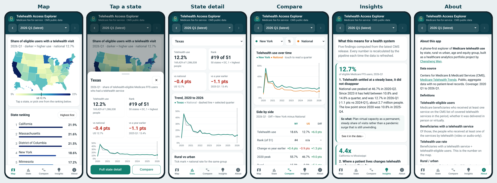

# Telehealth Access Explorer

**A phone-first app that shows where Medicare patients still use telehealth, and who depends on it most.** Tap any state to see its trend since 2020, rural vs urban use, age bands, equity gaps and its rank, all from public CMS data. It installs to your home screen and works offline.

Built with SQL (SQLite), Python (pandas, Jupyter) and a static D3 web app on GitHub Pages. Nothing to install to try it.



## Open on your phone


**Live app:** https://wenchensheng.github.io/telehealth-access-explorer/

Scan the QR code with your phone camera, or open the link in any browser.

- **iPhone:** open in Safari, tap **Share**, then **Add to Home Screen**.
- **Android:** open in Chrome, tap **⋮**, then **Install app** (or **Add to Home screen**).

The app then opens full screen from its own icon and keeps working without a connection.

<br clear="right">

## Business question

Telehealth surged in 2020. Six years later, **how much do Medicare patients still use it, and which states and patient groups rely on it most?** A health system leader needs the answer to size virtual-care capacity, set realistic targets against the right benchmark, and know whose access is at risk if the Medicare telehealth flexibilities, now extended through December 31, 2027 ([HHS](https://telehealth.hhs.gov/providers/telehealth-policy/telehealth-policy-updates)), are not renewed.

## Data source

[CMS Medicare Telehealth Trends](https://data.cms.gov/summary-statistics-on-use-and-payments/medicare-medicaid-service-type-reports/medicare-telehealth-trends), from the Centers for Medicare & Medicaid Services ([CSV, no login](https://data.cms.gov/sites/default/files/2026-09/TMEDTREND_PUBLIC_260914.csv)). The data covers 2020 Q1 to 2026 Q1, quarterly and annual, for 50 states, DC, territories and the nation, broken down by rural/urban, age, sex, race/ethnicity, dual Medicare-Medicaid status and Medicare entitlement.

- **Telehealth-eligible users:** beneficiaries with at least one service on the CMS telehealth services list, delivered in person or virtually.
- **Telehealth use rate:** beneficiaries with at least one telehealth service (video or audio-only) ÷ telehealth-eligible users.
- The data is public and aggregate, with no patient-level records and no PHI.

## Approach

1. **Fetch** (`src/fetch_cms.py`): downloads the official CSV. If offline, it falls back to a committed gzip snapshot of the same file.
2. **Clean + data-quality checks** (`src/clean.py`): 12 checks cover schema, geographies, unique keys, period coverage, suppressed cells, rate range, users ≤ eligible, rate = users ÷ eligible, and whether states sum to the national total. One warning is flagged: Vermont's 2026 Q1 denominator jumps 27% from the prior quarter. Results go to [`reports/data_quality.md`](reports/data_quality.md).
3. **SQLite + SQL** (`sql/`): state rankings with `RANK()`, change vs each state's 2020 peak and vs the same quarter of 2024, rural-urban gap by state, age gradient, and equity gaps by race/ethnicity and dual status. Outputs are saved as CSVs in [`reports/sql/`](reports/sql/).
4. **Findings** (`src/findings.py`): computes every number quoted here and in the app, so text and data can't drift apart.
5. **Notebook** ([`notebooks/analysis.ipynb`](notebooks/analysis.ipynb)): the executed analysis with charts and cross-checks against the SQL outputs.
6. **App** (`docs/`): a static PWA with vanilla JS and D3, plus a bundled public-domain US states map (us-atlas). It reads one 218 KB JSON file, has no server, and runs offline through a service worker.

## Key findings (latest quarter: 2026 Q1)

1. **Telehealth settled at a steady base; it did not disappear.** National use peaked at **46.7%** in 2020 Q2. Since 2023 it has held between **10.8% and 14.8%** a quarter, and was **12.7%** in 2026 Q1 (−1.1 pts vs 2024 Q1), about 2.7 million people. *So what:* plan virtual capacity as a permanent, steady share of visits.
2. **Where a patient lives changes telehealth use by more than 4x.** California leads at **21.9%** and Mississippi is lowest at **5.0%** (4.4x). Only **16 of 51** states (incl. DC) beat the national rate. *So what:* benchmark against your own state, not the national average.
3. **Rural patients use telehealth less than urban patients.** Nationally it's **9.9% rural vs 13.5% urban** (−3.5 pts). Rural use is lower in **37 of 50** states that report both groups, and the widest gap is in Minnesota (13.7% vs 19.1%). *So what:* rural access needs audio-only options, broadband help and scheduling support, not just a video link.
4. **Under-65 beneficiaries with disabilities are the heaviest users.** They use telehealth at **26.9%**, 2.2x the 65–74 rate (12.1%). By entitlement it's Disabled 27.3%, ESRD 19.9% and Aged 11.4%.
5. **Dual-eligible (low-income) beneficiaries use telehealth 2.1x as often as Medicare-only beneficiaries** (**22.8% vs 10.9%**), and the rate is higher in all 51 states. By race/ethnicity, Hispanic beneficiaries are highest at 16.1% and American Indian/Alaska Native lowest at 11.8% (Non-Hispanic White 12.1%).

The full text is in [`reports/findings.md`](reports/findings.md) and is regenerated on every run.

## App screens

| Screen | What you can do |
|---|---|
| **Map** | Tappable state map colored by use rate for the selected quarter, a legend with a national marker, and a full ranking list (tap any row). Tapping a state opens a detail sheet. |
| **State** | KPIs (rate, rank of 51, vs national, vs a year earlier), a 2020–2026 trend you can touch to read any quarter, rural vs urban, age bands, dual status and race/ethnicity, each with national reference ticks. |
| **Compare** | Two states, or a state vs national: overlaid trend lines and a side-by-side table with differences. |
| **Insights** | The five findings in plain language for a health system leader, each linked to the data. |
| **About** | Source and link, definitions, limitations, and install steps. |

A quarter selector (2020 Q1 to 2026 Q1) in the header drives every screen. Views have shareable links, for example `#compare/CA/MS?q=2024-Q3`.

## How to run

```bash
python -m venv .venv && source .venv/bin/activate
pip install -r requirements-dev.txt
python run_all.py                 # fetch -> clean -> SQL -> findings -> app JSON -> QR -> notebook (~5 s)
pytest -q                         # 8 tests
python -m http.server -d docs 8000   # open http://localhost:8000
# optional phone-size browser check + screenshots (needs Chrome):
python -m playwright install chromium   # or pass --chrome /path/to/chrome
python scripts/verify_mobile.py
```

Use `python run_all.py --offline` to build from the committed CMS snapshot without downloading.

## Project structure

```
run_all.py               one-command pipeline
src/                     fetch_cms, clean (data-quality), build_db, findings, export_app, make_qr
sql/                     00_schema + 7 analysis queries (rankings, change, rural gap, age, equity, trend)
notebooks/analysis.ipynb executed analysis with charts
reports/                 data_quality.md, findings.md, sql/*.csv outputs, verification.json
docs/                    the PWA (GitHub Pages root): index.html, app.js, styles.css, sw.js, manifest.json, icons/, data/, vendor/
scripts/                 verify_mobile.py (headless iPhone-size check), make_icons.py
tests/                   pytest suite
data/snapshot/           gzip copy of the CMS CSV for offline runs
images/                  phone screenshots and QR code
```

## Limitations

- **Medicare fee-for-service only.** Medicare Advantage enrollees are not included.
- The data counts people, not visits.
- CMS marks the data preliminary, so recent quarters may change as late claims arrive.
- Small cells are suppressed (shown as n/a), and DC has no rural ZIP codes.
- Rates are among *telehealth-eligible users*, not all beneficiaries.

## License

MIT for the code. The CMS data is public U.S. government data. Bundled d3, topojson-client and us-atlas are ISC-licensed (see `docs/vendor/THIRD_PARTY_LICENSES.md`).

---
Built by [Chensheng Wen](https://github.com/wenchensheng), healthcare data and BI analyst · SQL · Python · Tableau
